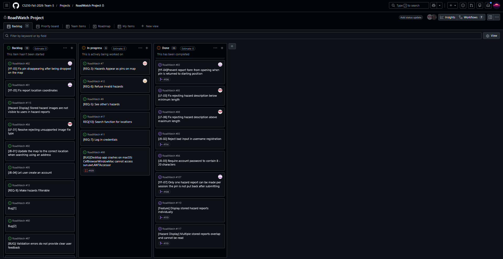

# PR4 Team Report

Team 6: Kolina Katoanga, Yomna Fassatoui, Jordan Baugh, Leo Freije

## 1. Bug Triage Table

| Test name | Bucket | Issue link | Severity | Priority | Owner | Status |
|---|---|---|---|---|---|---|
| YF-04: Form does not open when the pin is put back in its box | Code bug | [#83](https://github.com/CS250-Fall-2026-Team-5/RoadWatch/issues/83) | Low | Medium | Yomna | Fixed |
| Second hazard report in the same session (new test) | Code bug | [#107](https://github.com/CS250-Fall-2026-Team-5/RoadWatch/issues/107) | Medium | High | Yomna | Fixed |
| YF-03: Pin stays visible on the map | Code bug | [#82](https://github.com/CS250-Fall-2026-Team-5/RoadWatch/issues/82) | High | Medium | Yomna | Open |
| YF-05: Report stored at the pin position | Missing feature | [#81](https://github.com/CS250-Fall-2026-Team-5/RoadWatch/issues/81) | High | High | Yomna | Open |
| JB-01: Update the map to the correct location when searching using an address | Missing Feature | [#92](https://github.com/CS250-Fall-2026-Team-5/RoadWatch/issues/92) | High | High | Jordan | Open |
| JB-02: Reject bad input in username registration | Code Bug | [#93](https://github.com/CS250-Fall-2026-Team-5/RoadWatch/issues/93) | High | Medium | Jordan | Fixed |
| JB-03: Require account password to contain 8 - 20 characters | Code bug | [#94](https://github.com/CS250-Fall-2026-Team-5/RoadWatch/issues/95) | Medium | Medium | Jordan | Fixed |
| JB-04: Let user create an account | Missing feature | [#95](https://github.com/CS250-Fall-2026-Team-5/RoadWatch/issues/95) | High | High | Jordan | Open |

## 2. Regression Log

| Fix (PR) | Test that broke | How it was resolved |
|---|---|---|
| | | |

## 3. Final Test Run

Tests still failing:
- YF-03 (#82): on the desktop app the map is a Chromium view drawn on top of the UI, so the pin goes under it. Fixing it needs a new way to place the pin (clicking on the map).
- YF-05 (#81): the pin location was never geo-mapped, so every report gets the fixed location 32.7757, -117.0719. Sorted as a missing feature.
- JB-01 (#92): Although the search value is stored, and there seems to be a way to turn addresses into coordinates for google maps, there is no call directly to the map. To fix it we need to know how exactly the map is implemented on the main screen of the app and be able to call a function on said map to change the location.
- JB-04 (#95): There is no storage for accounts implemented yet, but the app has implementation for storing text inputs of username and passwords and verifying the data within.

## 4. Feature Decision

**Feature:**\
**User story:** As a Developer, I want users to have the ability to create an account, so that only they can edit their hazard reports, and that the website isn't flooded with bots.\
**Why we chose it:** Our team has created a registration / log ins system in our past project and feel it's the feature we could implement the best in the time frame we're working in.\
**Who owns which part:**\
**Login:** Kolina Kataonga\
**Account Registration:** Jedimind\
**Account Database:** Skyseye\
**Logout / Whatever else needs doing:** Yomna\
**Test case 1:** JB-04\
**Test case 2:** JB-02\
**Issue:** #123

## 5. Board Snapshot

## 6. Sprint Summary
Our team has managed to fix a great number of bugs this sprint. We've fixed issues related to the pin feature, the hazard reports, and the process of storing said hazard reports. Unfortunately, there are still many parts of the project that are missing, many features of which weren't implemented before we received the project and thus cannot be fixed. This swayed our decision somewhat when choosing our next feature, as we knew some of the missing features we wanted to implement couldn't take shape until we implemented a previous feature that did not work yet. This heavily influenced our decision on the feature to make for the next sprint: the account creation. We've got a rough outline on what to start with from the bugs fixed this sprint and a good division of work that'll let us get everything done within the time frame we've been given.

