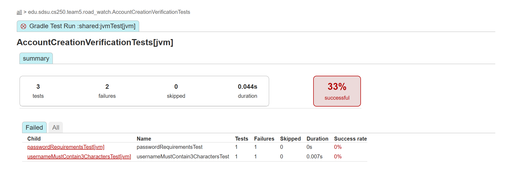
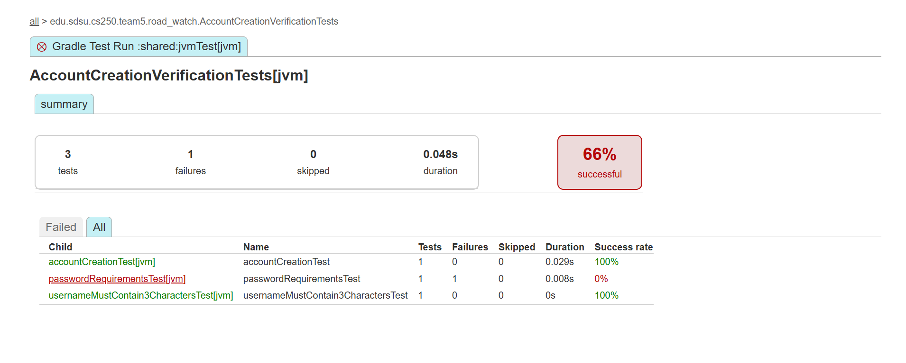

# Jordan Baugh

## Bug 1: Issue #93

Issue: https://github.com/CS250-Fall-2026-Team-5/RoadWatch/issues/93
PR: [link](https://github.com/CS250-Fall-2026-Team-5/RoadWatch/pull/114/)

Before:

After:

Code bug: There was no code at all to input or check if a username was within the pre-defined limits.

## Bug 2: Issue #94

Issue: https://github.com/CS250-Fall-2026-Team-5/RoadWatch/issues/94
PR: [link](/https://github.com/CS250-Fall-2026-Team-5/RoadWatch/pull/115/)

Before:

After:

Code bug: There was no code at all to input or check if a password was within the pre-defined limits.
