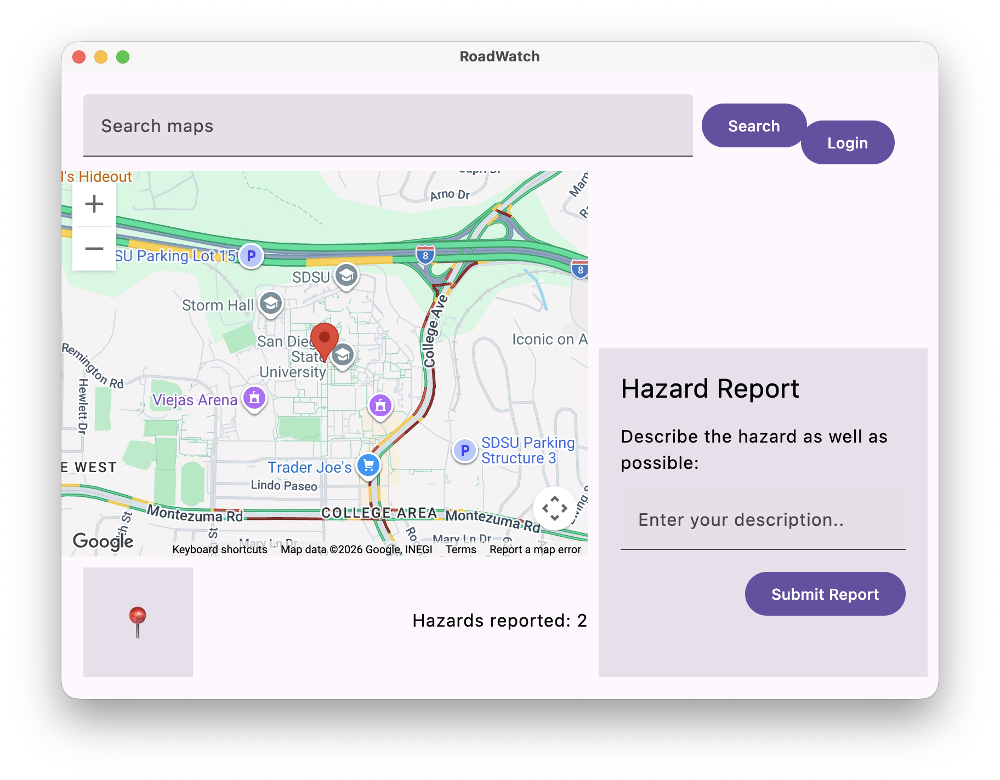
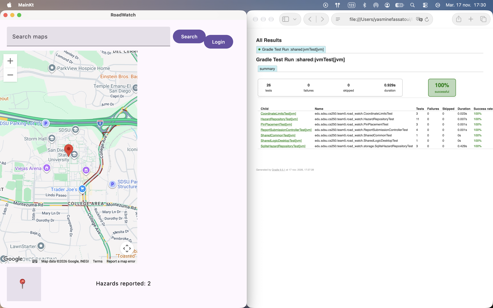
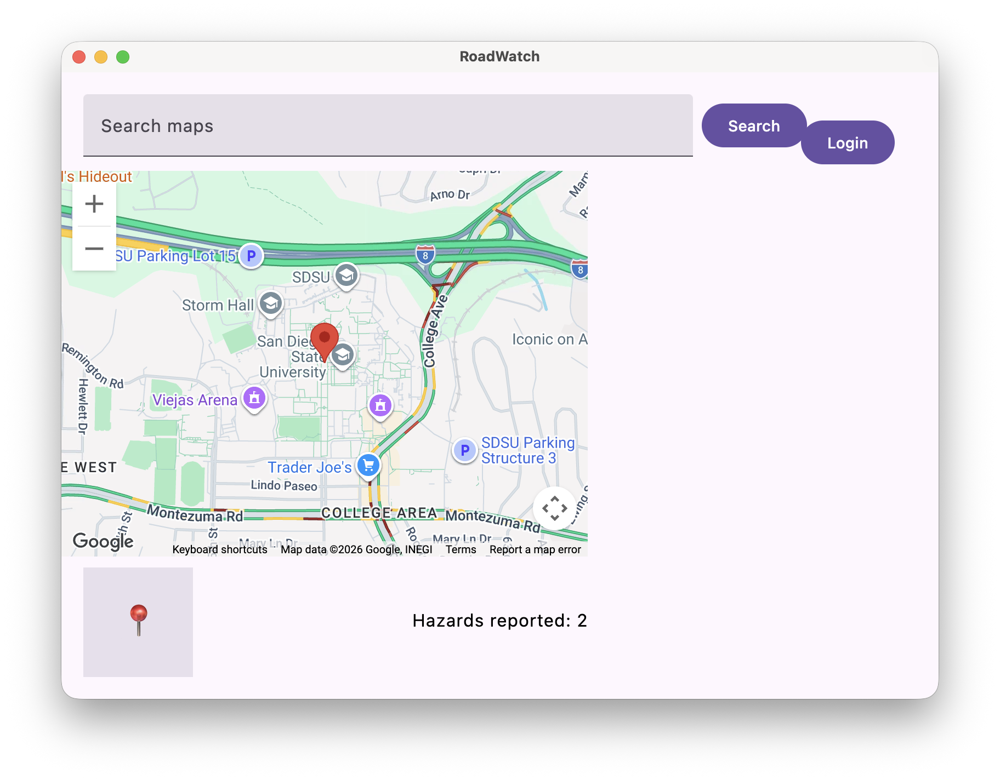

# Yomna Fassatoui

## Bug 1: Issue #83

Issue: https://github.com/CS250-Fall-2026-Team-5/RoadWatch/issues/83
PR: [link]

Before:

After:

Code bug: test YF-04 expects the form to stay closed when the pin goes back in its box, but the code opened the form every time the pin was released, without checking where it was.

## Bug 2: Issue #107

Issue: https://github.com/CS250-Fall-2026-Team-5/RoadWatch/issues/107
PR: [link]

Before:

After:

Code bug: The Submit Report button in App.kt reset the form and the description but never reset pinOffset, so the pin stayed where it was dropped and no second report could be made.
